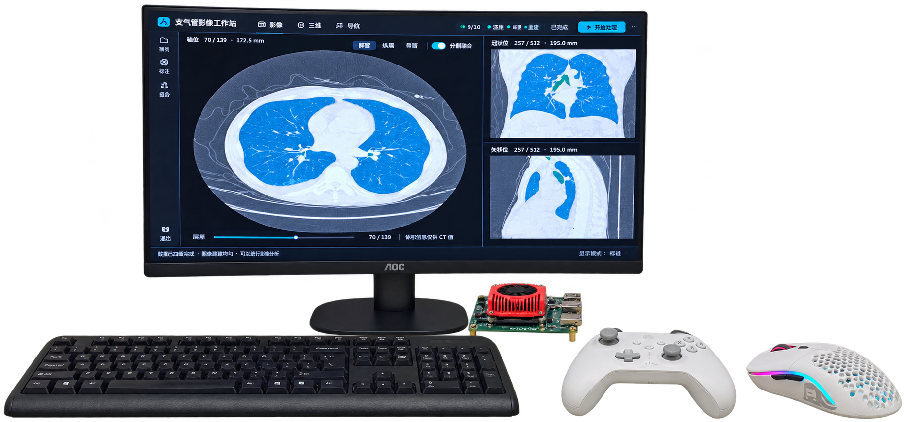
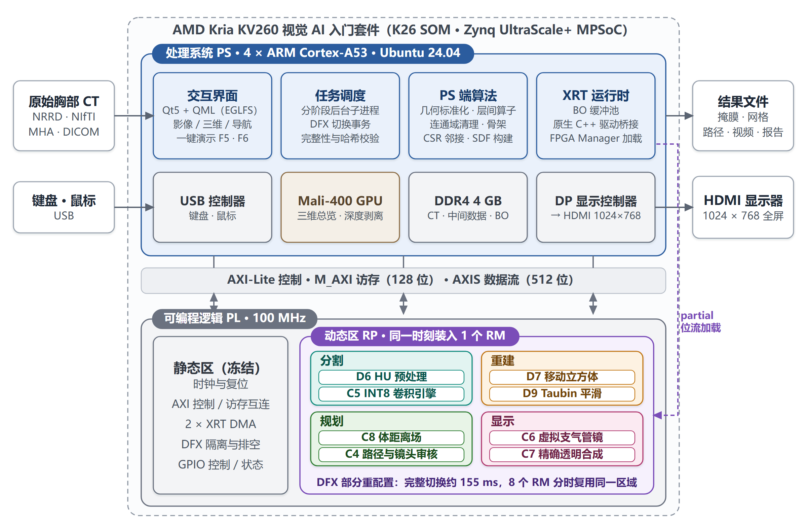
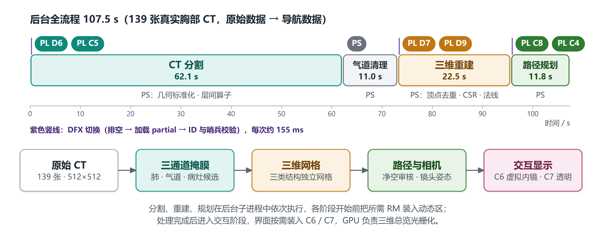
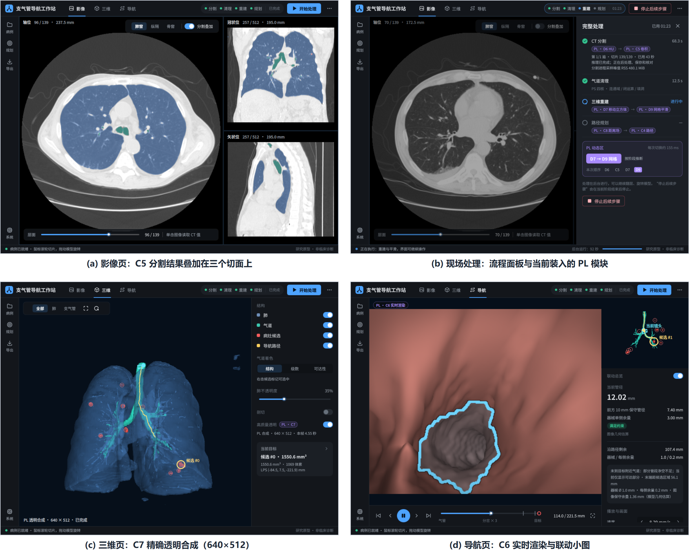

# 基于 KV260 动态部分重配置的支气管镜导航工作站

作者：**YaomoHuanyue**。本项目原创代码采用 [MIT License](LICENSE)。

公有仓库：[YaomoHuanyue/KV260_Medical](https://github.com/YaomoHuanyue/KV260_Medical)。默认分支为 `main`。当前 `vivado` 分支额外保存完整 Vivado 工程和构建候选；竞赛轻量源码位于 `main`。

在一块 AMD Kria KV260 上**脱机完成支气管镜术前规划的完整流程**：原始胸部 CT → 肺 / 气道 / 病灶候选分割 → 三维重建 → 按器械直径约束的路径规划 → 实时虚拟支气管镜。关键计算由 **8 个已部署的自研 PL 加速模块**承担，借助 **DFX 动态部分重配置**按处理阶段分时复用同一块可重配置区域。PS负责病例读取、任务调度、部分前后处理和界面交互；不使用 AMD DPU，运行时不静默回退到 PS。

> 研究原型，结果仅供参考，不用于临床诊断。病灶为模型候选。



## 主要特性

- **关键计算环节 PL 加速**：HU 预处理（D6）、INT8 卷积（C5）、移动立方体（D7）、Taubin 网格平滑（D9）、体距离场（C8）、路径与镜头审核（C4）、虚拟支气管镜渲染（C6）、精确透明合成（C7），全部为 Vitis HLS 自研内核。
- **DFX 分时复用**：8 个模块共用一块可重配置分区，统一 AXI-Lite / M_AXI / AXIS 接口；切换时排空总线、加载局部位流、校验 RM 身份与 DDR 哨兵，完整切换约 155 ms，失败即报错。
- **网络—引擎协同设计**：2.5D 三头 U-Net（156,947 参数），18 个卷积层全部映射到同一 C5 引擎，每周期 512 次乘加，阵列利用率约 94%。
- **无独立显卡的实时可视化**：PL 光线步进虚拟支气管镜（640×512），GPU 深度剥离 + PL 逐像素排序的最多 32 层精确透明。
- **导航关键数据**：虚拟支气管镜画面实时显示所在支气管级数、下一分岔距离与转向、到病灶直线距离；侧栏显示路径进度、前方最窄处、目标信息与 PL 渲染帧率。
- **结果可验证**：每个 PL 模块都有软件参考实现，经 HLS 仿真、RTL 协同仿真与板上逐位比对。
- **开机即用**：Qt5 + QML 全屏界面经 EGLFS/KMS 直出 HDMI；鼠标键盘或冰原狼 4 手柄（双摇杆导航）操作；内置 F5 一键演示与 F6 现场处理演示。

## 实测指标

以下为已验收固件的历史KV260板测数据，139张胸部CT（512×512）；不是本轮独立源码重建的新测试结果。

| 指标 | 结果 |
|---|---|
| 完整处理（分割 → 清理 → 重建 → 规划） | 107.5 s |
| 分割网络推理 | 27.95 s（同模型 ARM 实现 140.29 s，约 5.0 倍） |
| 虚拟支气管镜帧率 | 15.3 帧/秒（640×512） |
| DFX 完整切换 | 154.9～161.9 ms |
| 整板功耗（K26 SOM，INA260） | 空闲 3.36 W；处理平均 3.97 W，峰值 5.17 W |
| 开机至界面就绪 | 约 66 s |

## 系统架构



一次完整处理中，各阶段开始前由运行时把所需模块装入动态区：



| 模块 | 功能 | 占动态区 LUT |
|---|---|---:|
| D6 | HU 预处理 | 6% |
| C5 | INT8 卷积引擎（reader / conv / writer） | 89% |
| D7 | 移动立方体 | 13% |
| D9 | 受约束 Taubin 平滑 | 88% |
| C8 | 体距离场 | 49% |
| C4 | 路径、净空审核与镜头 | 88% |
| C6 | 虚拟支气管镜渲染 | 25% |
| C7 | 精确透明合成 | 8% |

动态区容量 88,320 LUT / 960 DSP，全部模块在 100 MHz 下时序收敛并通过 `pr_verify`。



## 目录结构

| 位置 | 内容 |
|---|---|
| `ui/v3/` | 当前前端（Qt Widgets 状态模型 + QML 外框）、发布清单与启动器 |
| `modules/` | 分割、气道清理、重建、导航、手柄、导出等后端模块 |
| `system/` | 调度、部分重配置事务与开机自启服务 |
| `dfx/` | 各 DFX 模块的 HLS 源码、主机桥接与已验收固件（LFS） |
| `accelerators/` | C5 突发读取 reader |
| `hardware/` | HLS / RM 目标清单、RM 创建与实现脚本、AMD Ross 导出的静态工程、冻结静态检查点（LFS） |
| `vivado/` | 可直接打开的独立 Vivado 工程、主平台及 MC 接口 BD、本轮 MC 候选与真实构建报告 |
| `scripts/` | 工程检查、前端 / 原生库构建、HLS 流程、病例配置 |
| `docs/` | 构建说明、验证记录、来源与第三方说明 |
| `results/` | 已验收版本的精简验证记录 |

## 快速开始

### 1. 获取工程

```bash
git lfs install
git clone https://github.com/YaomoHuanyue/KV260_Medical.git && cd KV260_Medical
git lfs pull
python3 scripts/check_project.py --source-only
```

局部位流、冻结检查点、已验收 ARM 库、模型权重和字体由 Git LFS 管理。原始 CT、病例输出、训练数据和 Python 环境均不入库。
冻结的发布清单按字节校验，请勿批量转换行尾（见 `.gitattributes`）。

### 2. 构建前端（KV260，Ubuntu 24.04 / aarch64）

需要 g++、pkg-config、Qt5（Widgets / OpenGL / Quick / QuickWidgets / Qml / Test）开发包及 moc / rcc。

```bash
python3 scripts/build_software.py --jobs 2
```

输出 `ui/v3/bin/medical_ui`，同时执行控件检查和 181 项手柄 / 镜头断言。Python 依赖见 `requirements.txt`，请自建虚拟环境。

### 3. 配置病例并运行

把自己的 CT 放入被 Git 忽略的 `data/` 目录：

```bash
python3 scripts/configure_case.py --ct data/CT.nrrd
sudo .venv/bin/python -B ui/v3/runtime.py --input "$PWD/data/CT.nrrd"
```

运行需要已验收的 DFX 静态平台、局部位流、XRT 与 Mali 驱动环境，详见 [软件与部署](docs/BUILD_SOFTWARE.md)。开机自启服务位于 `system/autostart/`。

### 4. 使用

- **影像 / 三维 / 导航**三个页面；点击"开始处理"从原始 CT 执行完整流程。
- **F5** 一键演示（约 3 分钟），**F6** 现场完整处理演示；任意按键退出演示。
- 手柄：左摇杆前进 / 后退，右摇杆转向与俯仰，参数见 `modules/gamepad/config.json`。

## FPGA 构建

器件 `xck26-sfvc784-2LV-c`，AMD Vivado / Vitis HLS **2025.2.1**，PL 100 MHz。

直接打开 `vivado/project/KV260_Medical.xpr` 可查看主平台 `system_ps.bd` 和 MC 接口 `algorithm_mc.bd`。独立工程的验证范围见 `vivado/reports/VALIDATION.md`：静态源综合和本轮 MC 综合布线已通过，其余 RM 的完整重建及 Project-Mode DFX 配置集成仍在继续；已验收固件不因本次工程整理而改变。

源码清单包含11个HLS核和9个RM构建目标，包含导航表面渲染的不同实现版本；这与运行时8个处理模块的口径不同。主BD展示静态平台，算法位于 `rp` 动态分区。`algorithm_mc.bd`展示MC接口，生产RM仍使用RTL边界适配器。工程目录自带冻结静态检查点，后续实现优先复用该静态区。

```bash
python scripts/run_hls.py hu32 csim    --tools /opt/amd/2025.2.1/Vitis
python scripts/run_hls.py hu32 csynth  --tools /opt/amd/2025.2.1/Vitis
```

静态工程可由 `hardware/ross_export/Scripts/build.tcl` 还原；各 RM 通过 `hardware/rm/<target>.tcl`、`synthesize_rm.tcl`、`implement_rm.tcl` 在冻结静态检查点上实现。完整步骤见 [FPGA 构建](docs/BUILD_FPGA.md)。新生成的位流先作为候选，完成数值与板端验证后才可替换正式版本。

## 验证范围

本仓库的独立构建与检查结果见 [验证记录](docs/VALIDATION.md)。冻结固件的时序、PR 与板测结论保留其原有日期与范围，不因本仓库的工程还原而重新声明。

## 第三方与许可

AMD Ross（固定提交 `2cdc9eef`）用于工程导出与 HLS 流程；字体、图标、AMD IP及工具生成产物等第三方内容继续适用各自原有许可，根目录MIT许可证不替换这些许可。详见 [第三方说明](docs/THIRD_PARTY.md)。
